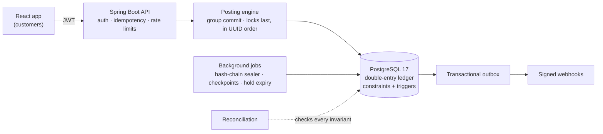

# SmartBank

**A double-entry banking ledger that stays correct under retries, concurrency and failures.** Java 21, Spring Boot and PostgreSQL, with a React frontend.

**Educational simulation only.** All data is synthetic. Do not expose it to the internet or use real personal or financial data.

## Why it is interesting

- **The database refuses bad money states, even if the code is wrong.** Every transaction's debits must equal its credits within each currency; history is append-only; balances can never go negative. These are PostgreSQL constraints and triggers, not application checks.
- **Every request is safe to retry.** Idempotency keys make each payment happen exactly once, even when the server stops between posting and answering.
- **History cannot be quietly rewritten.** The app connects as a database role that can add to the ledger but cannot update, delete or disable the triggers that protect it. Committed transactions are sealed into a SHA-256 hash chain, and each seal is signed with an Ed25519 key the database never holds, so even someone with full database access who rewrites the whole chain is caught.
- **It is tested like infrastructure.** Seeded simulations replay the whole bank with crashes and lost responses injected, against an independent model; thousands of concurrent operations; network cuts and `SIGKILL`s of PostgreSQL under load; and reconciliation of every invariant after every test.

## Architecture



## Results

| What | Result | Source |
| --- | --- | --- |
| 100 identical transfers fired at once with one idempotency key | Posted exactly once; every caller gets the same transaction | [`ConcurrencyIntegrationTest`](backend/src/test/java/com/smartbank/transaction/ConcurrencyIntegrationTest.java) |
| 5,000 random concurrent transfers (32 threads) | Money conserved, no negative balance, no deadlock, ledger reconciles | [`ConcurrencyIntegrationTest`](backend/src/test/java/com/smartbank/transaction/ConcurrencyIntegrationTest.java) |
| PostgreSQL killed with `SIGKILL` twice under load | Every acknowledged transfer survives, nothing posts twice | [fault testing](docs/fault-testing.md) |
| 40 seeded simulations of the bank, with crashes before commit and lost responses injected | Every step matches an independent model, nothing happens twice, a seed replays identically, and failures shrink to a few steps | [`LedgerSimulationTest`](backend/src/test/java/com/smartbank/fault/LedgerSimulationTest.java) |
| A transfer, its entries and both balances altered consistently | Missed by every balance check, caught by the hash chain | [`LedgerSealTest`](backend/src/test/java/com/smartbank/ledger/LedgerSealTest.java) |
| The whole chain rewritten by someone with full database access | Caught by seal signatures, with no external record | [`SealSignatureTest`](backend/src/test/java/com/smartbank/ledger/SealSignatureTest.java) |
| The app's own database role tries to update, delete, truncate or disable triggers on history | All 17 attempts refused, while every operation still works | [`AppRoleTest`](backend/src/test/java/com/smartbank/security/AppRoleTest.java) |
| Database round trips per transfer | 17 → 6, measured with injected network delay | [benchmarks](docs/benchmarks.md#round-trips-per-operation) |
| Batched posting (group commit), every transfer paying one account | About 3× the throughput (≈700 → ≈2,100+ transfers/s) and p99 latency ≈300 ms → under 30 ms, on a quiet machine | [benchmarks](docs/benchmarks.md#batched-posting-group-commit) |

The test suite has over 200 tests; [docs/testing.md](docs/testing.md) lists what each group proves.

## A transfer, in short

```
POST /api/v1/transfers   Idempotency-Key: 7f3c…   { fromAccountId: A, toAccountId: B, amount: "100.00" }
  → 201 TRANSFER
     ledger:  DR customer A 100.00 · CR customer B 100.00   (balanced and append-only, checked by the database)
     outbox:  transaction.posted, committed with the transfer, then delivered as a signed webhook
     seal:    covered by the next signed hash-chain seal

Same request, same key      → 201, byte-identical body, Idempotent-Replayed: true; nothing moves twice
Same key, different request → 422
```

The frontend covers accounts (with a total per currency), history, deposits, withdrawals, transfers by account number, holds (place, capture in full or in part, release), **statements** with a running balance, **currency exchange** at a quoted rate held for 60 seconds, and **refunds** of received transfers. Selecting a transaction shows the debit and credit lines it posted and the signed seal that covers it. Administrators get a **Ledger** page: the trial balance for each currency with its debits = credits and accounting-equation checks, and a **Verify history** button that rechecks the whole signed hash chain. Every page has its own URL, and it works on phones with a bottom tab bar. Vitest and React Testing Library tests cover the money formatting, the sign-in and routing, the transfer retry (same idempotency key), quote expiry and refunds.

## Features

- **Ledger:** double-entry with a chart of accounts and per-currency trial balances; balance checkpoints and statements; multi-currency with quoted FX; reversals that never edit history; a signed hash chain over all history.
- **Money movement:** deposits, withdrawals and transfers; two-phase transfers (holds) with capture, release and expiry; linked transfers that post all or nothing; batched posting (group commit).
- **Reliability:** idempotency keys scoped per user; short, deadlock-free locking; a transactional outbox with signed, retried webhooks; reconciliation of every invariant.
- **Security:** the app runs as a database role that cannot rewrite history; JWT and BCrypt; ownership checks on every account; per-user and per-IP rate limits in PostgreSQL; SSRF-guarded webhooks with encrypted, rotatable secrets.

## Documentation

- [How SmartBank works](docs/design.md): the ledger, FX, tamper evidence, the database role, checkpoints, holds, linked transfers and idempotency, in detail
- [Testing](docs/testing.md): what every test group proves, and how to run them
- [API reference](docs/api.md)
- [Benchmarks](docs/benchmarks.md), [fault testing](docs/fault-testing.md), [webhooks](docs/webhooks.md)

## Tech stack

Java 21, Spring Boot 3.5, Spring Data JPA, Spring Security (OAuth2 resource server, JWT), PostgreSQL 17, Flyway, Testcontainers, Toxiproxy, JUnit 5, Mockito, React 19, TypeScript, Vite, Vitest, React Testing Library, Docker Compose, GitHub Actions.

## Run it locally

Requirements: Docker. The backend needs PostgreSQL 17 or later (Docker Compose provides it). Node.js 20.19+ for the frontend. JDK 21 and Maven are optional; tests can run in Docker.

Start PostgreSQL and the API (API on `http://localhost:8081`):

```bash
docker compose -f infra/compose.yml up --build -d
```

Start the frontend (`http://localhost:5173`, proxies `/api` to the backend):

```bash
cd frontend && npm install && npm run dev
```

Log in as `demo.a@smartbank.local` or `demo.b@smartbank.local` (customers), or `demo.admin@smartbank.local` (the Ledger page), with the local demo password set in `infra/compose.yml`. Demo user A owns `DEMO-10001` (CAD) and `DEMO-10003` (USD, for trying FX); demo user B owns `DEMO-10002` (CAD). Demonstration CAD/USD rates are seeded.

Stop without deleting data with `docker compose -f infra/compose.yml down`. Adding `-v` deletes the database volume.

Run the tests with `cd backend && mvn test` (JDK 21), or entirely in Docker as described in [docs/testing.md](docs/testing.md#run-the-tests).

## Project layout

- `backend/src/main/java/com/smartbank/account`: accounts API, entity and locking repository
- `backend/src/main/java/com/smartbank/transaction`: deposits, withdrawals, transfers, holds, idempotency
- `backend/src/main/java/com/smartbank/ledger`: ledger entries, chart of accounts, trial balance, reconciliation
- `backend/src/main/java/com/smartbank/events`: outbox, webhook endpoints, signed delivery worker
- `backend/src/main/java/com/smartbank/idempotency`: per-user idempotency keys, stored responses, pruning
- `backend/src/main/java/com/smartbank/ratelimit`: token-bucket limiter, limits, filter
- `backend/src/main/java/com/smartbank/auth`: JWT login, registration, ownership checks
- `backend/src/main/resources/db/migration`: Flyway schema (V1 accounts, V2 transactions, V3 users and ownership, V4 ledger, V5 holds, V6 idempotency keys, V7 outbox and webhooks, V8 linked transfers, V9 reversals, V10 rate limits, V11 webhook hardening, V12 chart of accounts, V13 seals and initiator, V14 balance checkpoints, V15 multi-currency and FX, V16 app database role, V17 signed seals)
- `backend/src/test`: unit, integration, concurrency, simulation and fault-injection tests, and the hot-account benchmark
- `frontend`: React + TypeScript UI
- `docs`: design, testing, API, benchmarks and fault testing
- `infra/compose.yml`: local PostgreSQL and backend

## Limitations and roadmap

Not implemented: refresh tokens or token revocation, MFA, account opening, pagination beyond the newest 100 transactions, FX revaluation and FX reversals. The demo password, JWT secret and webhook encryption key in `infra/compose.yml` are for local use only, and Compose allows http and private webhook targets so a receiver on your machine works; production must set `WEBHOOK_ENCRYPTION_KEY` and leave `WEBHOOK_ALLOW_HTTP` and `WEBHOOK_ALLOW_PRIVATE_TARGETS` off.

Next steps:
- Close the remaining DNS-rebinding window for webhooks with an egress proxy, and allow rotating the secret-encryption key.

Development history by sprint: [Sprint 2](SPRINT2_README.md) (transactions), [Sprint 3](SPRINT3_README.md) (authentication), [frontend](frontend/README.md).
