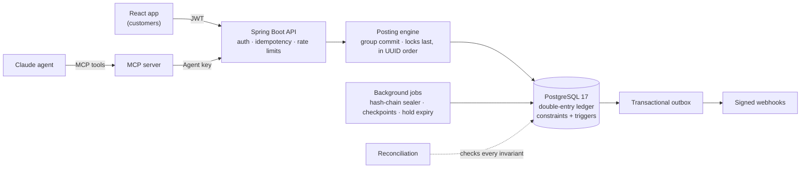

# SmartBank

[](https://github.com/jessicalanggg/smartbank/actions/workflows/ci.yml)

**A double-entry banking ledger that lets AI agents spend money within limits the database enforces.** Java 21, Spring Boot and PostgreSQL, with a React frontend and an MCP server for agents.

**Educational simulation only.** All data is synthetic. Do not expose it to the internet or use real personal or financial data.

## Why it is interesting

- **The database refuses bad money states, even if the code is wrong.** Every transaction's debits must equal its credits within each currency; history is append-only; balances can never go negative; an agent's spending can never exceed its daily limit. These are PostgreSQL constraints and triggers, not application checks.
- **AI agents get a budget, not a blank check.** A customer gives an agent a key tied to one account, with per-payment and daily limits. The limit is checked and used up in the same transaction as the payment, so 50 agents racing for the last of a budget cannot overspend it. Anything over a limit waits for the customer's approval, and revoking is immediate.
- **Every request is safe to retry.** Idempotency keys make each payment happen exactly once, even when the server stops between posting and answering.
- **History cannot be quietly rewritten.** The app connects as a database role that can add to the ledger but cannot update, delete or disable the triggers that protect it. Committed transactions are sealed into a SHA-256 hash chain, and each seal is signed with an Ed25519 key the database never holds, so even someone with full database access who rewrites the whole chain is caught.
- **It is tested like infrastructure.** Thousands of random concurrent operations checked against an independent model, network cuts and `SIGKILL`s of PostgreSQL under load, and reconciliation of every invariant after every test.

## Architecture



## Results

| What | Result | Source |
| --- | --- | --- |
| 50 simultaneous agent payments of 3.00 against a 100.00 daily limit | Exactly 33 post (99.00), 17 are refused, every run | [`AgentMandateTest`](backend/src/test/java/com/smartbank/agent/AgentMandateTest.java) |
| 5,000 random concurrent transfers (32 threads) | Money conserved, no negative balance, no deadlock, ledger reconciles | [`ConcurrencyIntegrationTest`](backend/src/test/java/com/smartbank/transaction/ConcurrencyIntegrationTest.java) |
| PostgreSQL killed with `SIGKILL` twice under load | Every acknowledged transfer survives, nothing posts twice | [fault testing](docs/fault-testing.md) |
| 4,800 random operations per run against an independent model | Match after every step; failures shrink to a minimal case | [`LedgerModelTest`](backend/src/test/java/com/smartbank/fault/LedgerModelTest.java) |
| A transfer, its entries and both balances altered consistently | Missed by every balance check, caught by the hash chain | [`LedgerSealTest`](backend/src/test/java/com/smartbank/ledger/LedgerSealTest.java) |
| The whole chain rewritten by someone with full database access | Caught by seal signatures, with no external record | [`SealSignatureTest`](backend/src/test/java/com/smartbank/ledger/SealSignatureTest.java) |
| The app's own database role tries to update, delete, truncate or disable triggers on history | All 17 attempts refused, while every operation still works | [`AppRoleTest`](backend/src/test/java/com/smartbank/security/AppRoleTest.java) |
| Database round trips per transfer | 17 → 6, measured with injected network delay | [benchmarks](docs/benchmarks.md#round-trips-per-operation) |
| Batched posting, every transfer paying one account | About 5–6× the throughput, p99 under 80 ms | [benchmarks](docs/benchmarks.md#batched-posting-group-commit) |

The test suite has over 200 tests; [docs/testing.md](docs/testing.md) lists what each group proves.

## An agent paying, in short

```
Customer:  POST /api/v1/mandates  { accountId, perPaymentLimit: "50.00", dailyLimit: "120.00", allowedPayeeAccountNumbers: ["DEMO-10002"] }
           → apiKey "sbk_agent_…" (shown once)

Agent:     POST /api/v1/agent/payments   Authorization: Agent sbk_agent_…   Idempotency-Key: order-1
           { toAccountNumber: "DEMO-10002", amount: "45.00", intent: "Wireless headphones" }   → POSTED
           { …, amount: "180.00", intent: "27-inch monitor" }                                  → PENDING_APPROVAL

Customer:  POST /api/v1/agent-payments/{id}/approve   → APPROVED, money moves
```

Try it with Claude: [agent-demo](agent-demo/) is an MCP server exposing this API as tools, and a script in which Claude shops through it. The frontend's **AI agents** page creates mandates, shows each agent's spending, and approves, declines or revokes.

## Features

- **Ledger:** double-entry with a chart of accounts and per-currency trial balances; balance checkpoints and statements; multi-currency with quoted FX; reversals that never edit history; a signed hash chain over all history.
- **Money movement:** deposits, withdrawals and transfers; two-phase transfers (holds) with capture, release and expiry; linked transfers that post all or nothing; batched posting (group commit).
- **AI agents:** spending mandates with per-payment and daily limits, allowed payees, owner approval above limits, immediate revocation and a full audit trail; an MCP server.
- **Reliability:** idempotency keys scoped per user; short, deadlock-free locking; a transactional outbox with signed, retried webhooks; reconciliation of every invariant.
- **Security:** the app runs as a database role that cannot rewrite history; JWT and BCrypt; ownership checks on every account; per-user, per-agent and per-IP rate limits in PostgreSQL; SSRF-guarded webhooks with encrypted, rotatable secrets.

## Documentation

- [How SmartBank works](docs/design.md): the ledger, FX, agent spending, tamper evidence, checkpoints, holds, linked transfers and idempotency, in detail
- [Testing](docs/testing.md): what every test group proves, and how to run them
- [API reference](docs/api.md)
- [Benchmarks](docs/benchmarks.md), [fault testing](docs/fault-testing.md), [webhooks](docs/webhooks.md)
- [Agent demo](agent-demo/README.md)

## Tech stack

Java 21, Spring Boot 3.5, Spring Data JPA, Spring Security (OAuth2 resource server, JWT), PostgreSQL 17, Flyway, Testcontainers, Toxiproxy, JUnit 5, Mockito, React 19, TypeScript, Vite, Docker Compose, GitHub Actions.

## Run it locally

Requirements: Docker. The backend needs PostgreSQL 17 or later (Docker Compose provides it). Node.js 20.19+ for the frontend. JDK 21 and Maven are optional; tests can run in Docker.

Start PostgreSQL and the API (API on `http://localhost:8081`):

```bash
docker compose -f infra/compose.yml up --build -d
```

Start the frontend (`http://localhost:5173`, proxies `/api` to the backend):

```bash
cd frontend && npm install && npm run dev
```

Log in as `demo.a@smartbank.local` or `demo.b@smartbank.local` with the local demo password set in `infra/compose.yml`. Demo user A owns `DEMO-10001` (CAD) and `DEMO-10003` (USD, for trying FX); demo user B owns `DEMO-10002` (CAD). Demonstration CAD/USD rates are seeded.

Stop without deleting data with `docker compose -f infra/compose.yml down`. Adding `-v` deletes the database volume.

Run the tests with `cd backend && mvn test` (JDK 21), or entirely in Docker as described in [docs/testing.md](docs/testing.md#run-the-tests).

## Project layout

- `backend/src/main/java/com/smartbank/account`: accounts API, entity and locking repository
- `backend/src/main/java/com/smartbank/transaction`: deposits, withdrawals, transfers, holds, idempotency
- `backend/src/main/java/com/smartbank/ledger`: ledger entries, chart of accounts, trial balance, reconciliation
- `backend/src/main/java/com/smartbank/events`: outbox, webhook endpoints, signed delivery worker
- `backend/src/main/java/com/smartbank/idempotency`: per-user idempotency keys, stored responses, pruning
- `backend/src/main/java/com/smartbank/ratelimit`: token-bucket limiter, limits, filter
- `backend/src/main/java/com/smartbank/auth`: JWT login, registration, ownership checks
- `agent-demo`: MCP server for agent payments, and a Claude agent demo (TypeScript)
- `backend/src/main/resources/db/migration`: Flyway schema (V1 accounts, V2 transactions, V3 users and ownership, V4 ledger, V5 holds, V6 idempotency keys, V7 outbox and webhooks, V8 linked transfers, V9 reversals, V10 rate limits, V11 webhook hardening, V12 chart of accounts, V13 seals and initiator, V14 balance checkpoints, V15 multi-currency and FX, V16 agent mandates)
- `backend/src/test`: unit, integration, concurrency, model-based and fault-injection tests, and the hot-account benchmark
- `frontend`: React + TypeScript UI
- `docs`: design, testing, API, benchmarks and fault testing
- `infra/compose.yml`: local PostgreSQL and backend

## Limitations and roadmap

Not implemented: refresh tokens or token revocation, MFA, account opening, pagination beyond the newest 100 transactions, FX revaluation and FX reversals. The demo password, JWT secret and webhook encryption key in `infra/compose.yml` are for local use only, and Compose allows http and private webhook targets so a receiver on your machine works; production must set `WEBHOOK_ENCRYPTION_KEY` and leave `WEBHOOK_ALLOW_HTTP` and `WEBHOOK_ALLOW_PRIVATE_TARGETS` off.

Next steps:
- Record a run of the Claude agent demo for this README.
- Re-run the throughput benchmarks on a quiet machine.
- Close the remaining DNS-rebinding window for webhooks with an egress proxy, and allow rotating the secret-encryption key.
- Frontend navigation on phones (the sidebar is hidden below 520 px, leaving only the Overview page).

Development history by sprint: [Sprint 2](SPRINT2_README.md) (transactions), [Sprint 3](SPRINT3_README.md) (authentication), [frontend](frontend/README.md).
